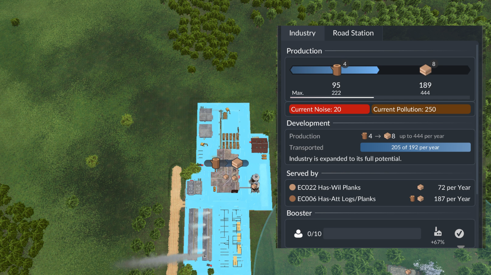
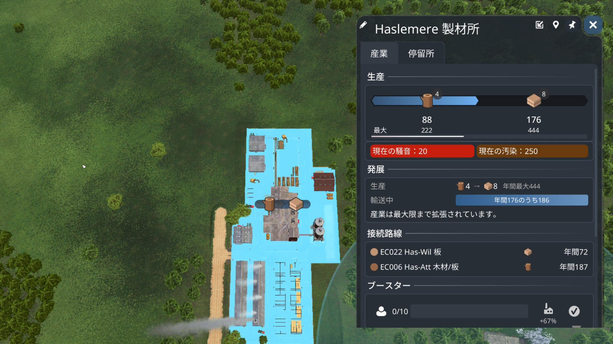

# Industry Pollution Display (Transport Fever 3)

[日本語は下にあります](#日本語)

Adds a card with the current noise and pollution to the windows of
industries, depots and maintenance buildings. The game shows these numbers
for vehicles and the headquarters, but not for the buildings whose emission
you most often want to check before building next to a town.



## Features

- **Industries:** the card sits between the production rules and the
  boosters. It shows the total of every emitting part of the industry's
  construction, so it changes with production (idle, producing, a full
  output stock) and with greenification.
- **Depots and maintenance buildings:** the card sits right under the
  maintenance pool, whose usage drives the emission. It shows the
  building's own emission only: a modded station with a built-in depot
  does not add the station's emission to the depot's.
- Uses the game's own noise and pollution card and rounds like the base
  windows, so the numbers read the same as on a vehicle or the
  headquarters.
- A building that emits nothing at all (e.g. a modded asset without
  emission data) shows no card rather than a misleading "0 / 0". A
  greenified industry at 0 still shows its card.

## How it works

The emissions game script of the base game writes the current noise and
pollution power into each emitter of a building as the game runs. The mod only
reads those values; it does not compute or change any emission.

- Both cards are react plugins at the base windows' extension points
  (`::IndustryEowExtensionPoint`, order 15, and
  `::MaintenanceStationEowExtensionPoint`, order 25). Nothing in the base
  game is replaced.
- The values are read in a step state, where the engine can be read safely,
  and follow the game as it runs.
- Logs: nothing while it works. A failed read shows no card and writes one
  `[IPD] emission read failed: ...` line per distinct error to the game log.

## Compatibility

- GUI only: it changes no save data, so it can be added to or removed from a
  running save at any time.
- No dependencies. Other mods that add cards to the same windows keep
  theirs; the cards are ordered by the extension point.

## Install

- mod.io: <https://mod.io/g/transportfever3/m/industry-pollution-display>
  (or subscribe in the game's mod hub).
- Manually: the game loads a local mod only from a folder named exactly
  `hummer_industry_pollution_display_1` inside
  `<Steam>/userdata/<your id>/3493540/local/mods/`.
  - From the release zip: create that folder and extract the zip **into**
    it (the zip has no top folder of its own).
  - From GitHub: `git clone https://github.com/hummer98/tpf3-industry-pollution-display.git hummer_industry_pollution_display_1`
    inside `local/mods/` (a different folder name will not load).
  - Then enable the mod in the game.

## Development

The code is plain Lua (`content/gui/`):

| File | Role |
|---|---|
| `ipd_core.lua` | Pure helpers (collect and sum emitters, rounding, log de-duplication), no engine access |
| `ipd.script.lua` | The two plugin recipes: reads the emitters and builds the card |
| `ipd.res.lua` | Registers the industry window plugin |
| `ipd_maintenance.res.lua` | Registers the depot / maintenance building window plugin |
| `_metadata/modinfo.json` | Name, summary and description for the game's mod list and the in-game mod.io upload. The game shows one text for all languages, so the name is "English / 日本語" and the description has a section per language |
| `_metadata/0.png` | Cover image (required by the in-game uploader, also shown in the mod list) |
| `docs/modio_description.md` | The same description for the mod.io web page |
| `docs/images/` | README screenshots (English one = the cover); not packed into the release zip |

Tests run offline with LuaJIT and stub the game API:

```sh
luajit tests/run.lua
```

`python3 tools/package.py` runs the tests and builds
`dist/hummer_industry_pollution_display_1.zip` with only the files the game
needs (no `.git`, tests or tools). LICENSE stays out too: the game's mod
validation rejects files without an allowed extension, so the mod
description states the licence and links here instead. It also stops when
the name or summary in `_metadata/modinfo.json` is longer than mod.io allows
(50 and 250 characters).

### Versions and releases

The version is in `VERSION` (`MAJOR.MINOR.PATCH`); `mod.json`'s `revision`
is MAJOR * 10000 + MINOR * 100 + PATCH. Changes are listed in
[CHANGELOG.md](CHANGELOG.md) and each version has a tag `vX.Y.Z` and a
GitHub release with the zip. `python3 tools/release.py patch` (or `minor`,
`major`, `X.Y.Z`; `--dry-run` to try) writes the version, the revision and
the changelog section, runs the checks, commits, tags and creates the
GitHub release.

To publish an update on mod.io, cut a release, then run
`python3 tools/stage.py`. It runs the same checks, refuses uncommitted
changes or an unraised revision, and rebuilds the game's staging copy
(`local/staging_area/hummer_industry_pollution_display_1`) while keeping the
`_metadata/mod.io_fileid.txt` the game wrote at the first upload, which is
what makes the upload update this mod instead of creating a new one. Then in
the game: MOD hub > My mods > Revalidate > Update. `--keep-revision` allows
a metadata-only update; `--first-upload` stages a mod not yet on mod.io.
Tool tests: `python3 -m unittest discover -s tests`.

## License

[MIT](LICENSE) © 2026 hummer

---

## 日本語

# 産業パネルに公害表示（Transport Fever 3）

産業・車庫・メンテナンス用建物のウィンドウに、現在の騒音と公害を示すカードを追加します。ゲームは車両や本社ではこの数値を出しますが、町の近くに建てる前にいちばん確かめたい建物では出しません。



### 機能

- **産業：** 生産ルールとブースターの間にカードを出します。産業の建物のうち排出するすべての部分の合計で、生産の状況（停止中・生産中・出荷在庫が満杯）と緑化で変わります。
- **車庫・メンテナンス用建物：** 整備プールのすぐ下にカードを出します。排出量は整備プールの使用量で決まります。表示するのはその建物自身の排出量だけで、車庫を組み込んだ Mod の駅などでも、駅の分は車庫に足しません。
- ゲーム本来の騒音・公害のカードを使い、丸め方も本体のウィンドウと同じなので、車両や本社の数値と同じ感覚で読めます。
- まったく排出しない建物（排出データのない Mod のアセットなど）には、誤解を招く「0 / 0」ではなくカード自体を出しません。緑化して 0 になった産業にはカードを出します。

### 仕組み

本体の排出ゲームスクリプトが、建物の各排出元に現在の騒音・公害の強さをゲームの進行に合わせて書き込みます。この Mod はその値を読むだけで、排出量を計算したり変えたりはしません。

- 2枚のカードは、本体ウィンドウの拡張ポイント（`::IndustryEowExtensionPoint` の order 15 と `::MaintenanceStationEowExtensionPoint` の order 25）に差し込む react プラグインです。本体のものは何も置き換えません。
- 値はエンジンを安全に読める step state で読み、ゲームの進行に合わせて変わります。
- ログ：正常に動いている間は何も出しません。読み取りに失敗したときはカードを出さず、エラーの種類ごとに1行 `[IPD] emission read failed: ...` をゲームのログに出します。

### 互換性

- GUI だけの Mod で、セーブデータを変更しません。プレイ中のセーブにいつでも追加・削除できます。
- 依存する Mod はありません。同じウィンドウにカードを足す他の Mod のカードもそのまま残り、拡張ポイントの順序で並びます。

### 導入

- mod.io：<https://mod.io/g/transportfever3/m/industry-pollution-display>（ゲーム内の MODハブからも購読できます）。
- 手動：ゲームは `<Steam>/userdata/<ID>/3493540/local/mods/` の中の、
  名前がちょうど `hummer_industry_pollution_display_1` のフォルダからだけ読み込みます。
  - リリースの zip から：そのフォルダを作り、その**中に** zip を展開します（zip には外側のフォルダがありません）。
  - GitHub から：`local/mods/` の中で `git clone https://github.com/hummer98/tpf3-industry-pollution-display.git hummer_industry_pollution_display_1` とします（別のフォルダ名では読み込まれません）。
  - そのあとゲーム内で有効にします。

### ライセンス

[MIT](LICENSE) © 2026 hummer
